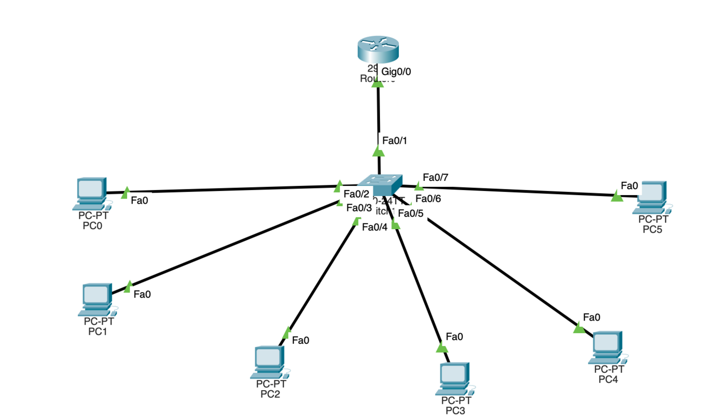
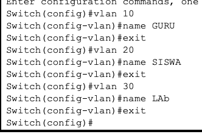
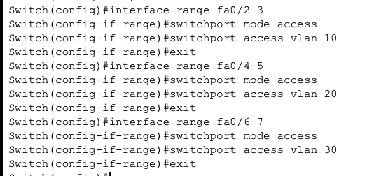
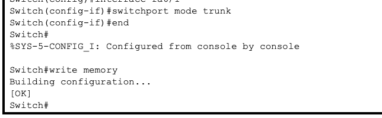
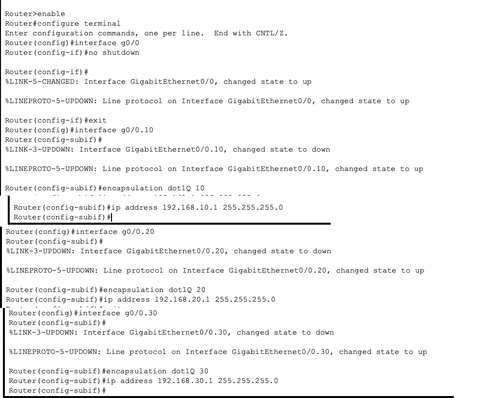
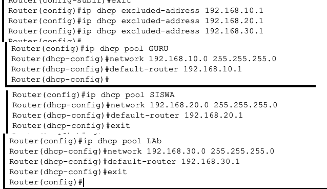
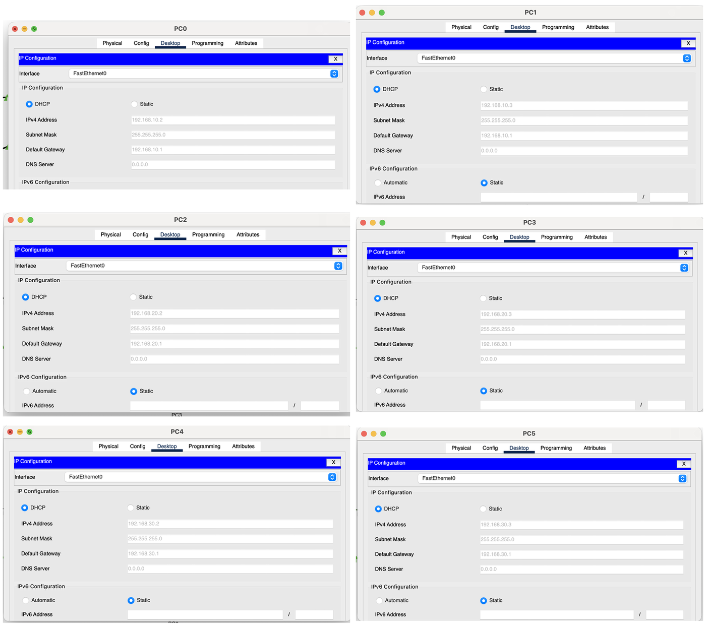
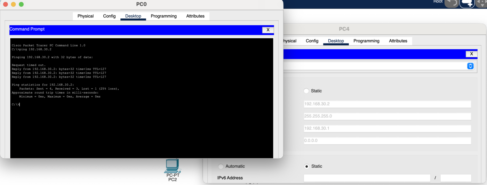

# VLAN & Inter-VLAN Routing di Cisco Packet Tracer

Latihan membagi jaringan sekolah jadi 3 VLAN (Guru, Siswa, Lab) dalam satu switch. Supaya antar VLAN tetap bisa terhubung, dipakai router dengan metode router-on-a-stick. IP untuk PC dibagikan otomatis lewat DHCP di router.

Dikerjakan oleh Nevan Kaindra Rusdi, SMK Bina Informatika (TKJ).

## Topologi



| VLAN | Nama | Port Switch | PC | Network | Gateway |
|---|---|---|---|---|---|
| 10 | GURU | Fa0/2–3 | PC0, PC1 | 192.168.10.0/24 | 192.168.10.1 |
| 20 | SISWA | Fa0/4–5 | PC2, PC3 | 192.168.20.0/24 | 192.168.20.1 |
| 30 | LAB | Fa0/6–7 | PC4, PC5 | 192.168.30.0/24 | 192.168.30.1 |

Router 2911 (G0/0) terhubung ke Switch 2960 di port Fa0/1 sebagai trunk.

## Konfigurasi Switch

Membuat VLAN:



Memasukkan port PC ke VLAN masing-masing (mode access):



Port ke router dijadikan trunk supaya bisa membawa semua VLAN:



## Konfigurasi Router

Port G0/0 dipecah jadi tiga sub-interface, satu untuk tiap VLAN. Masing-masing jadi gateway VLAN-nya.



DHCP server untuk tiap VLAN. Alamat gateway dikecualikan supaya tidak ikut dibagikan ke PC.



## Hasil

Semua PC dapat IP otomatis sesuai VLAN-nya:



Ping dari PC0 (VLAN 10) ke PC4 (VLAN 30) berhasil. Paket pertama timeout karena ARP masih mencari alamat tujuan, setelah itu reply normal.



## Ringkasan Perintah

```
! Switch
vlan 10
 name GURU
vlan 20
 name SISWA
vlan 30
 name LAB
interface range fa0/2-3
 switchport mode access
 switchport access vlan 10
interface range fa0/4-5
 switchport mode access
 switchport access vlan 20
interface range fa0/6-7
 switchport mode access
 switchport access vlan 30
interface fa0/1
 switchport mode trunk

! Router
interface g0/0
 no shutdown
interface g0/0.10
 encapsulation dot1Q 10
 ip address 192.168.10.1 255.255.255.0
interface g0/0.20
 encapsulation dot1Q 20
 ip address 192.168.20.1 255.255.255.0
interface g0/0.30
 encapsulation dot1Q 30
 ip address 192.168.30.1 255.255.255.0
ip dhcp excluded-address 192.168.10.1
ip dhcp excluded-address 192.168.20.1
ip dhcp excluded-address 192.168.30.1
ip dhcp pool GURU
 network 192.168.10.0 255.255.255.0
 default-router 192.168.10.1
ip dhcp pool SISWA
 network 192.168.20.0 255.255.255.0
 default-router 192.168.20.1
ip dhcp pool LAB
 network 192.168.30.0 255.255.255.0
 default-router 192.168.30.1
```
